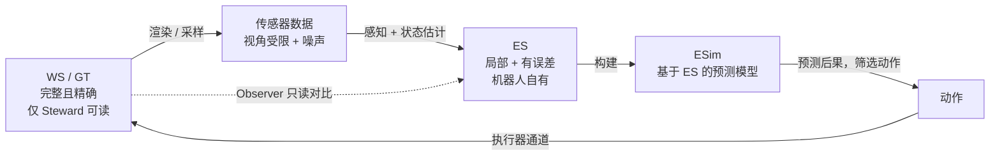
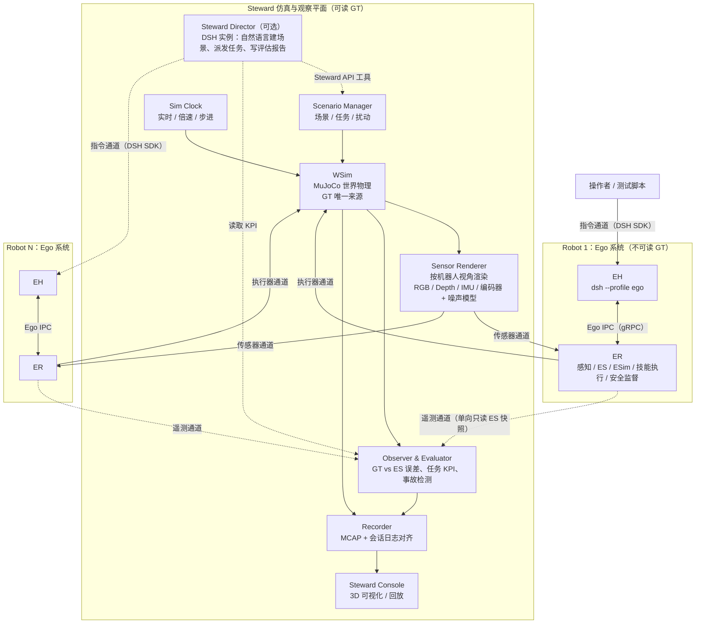
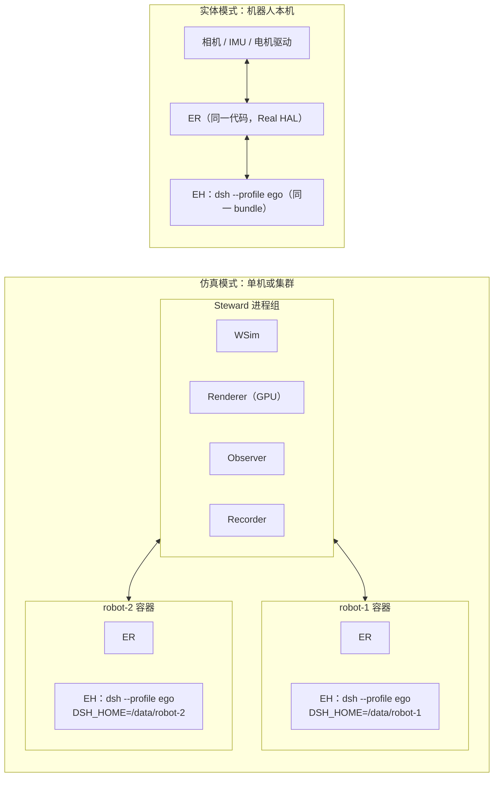
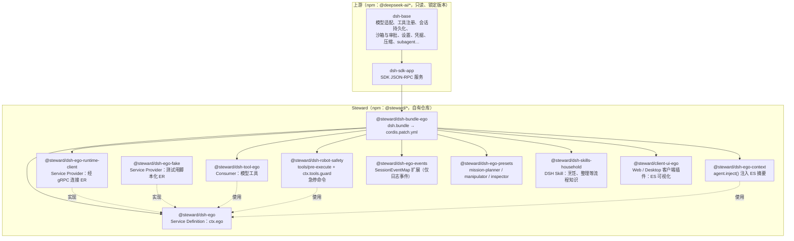
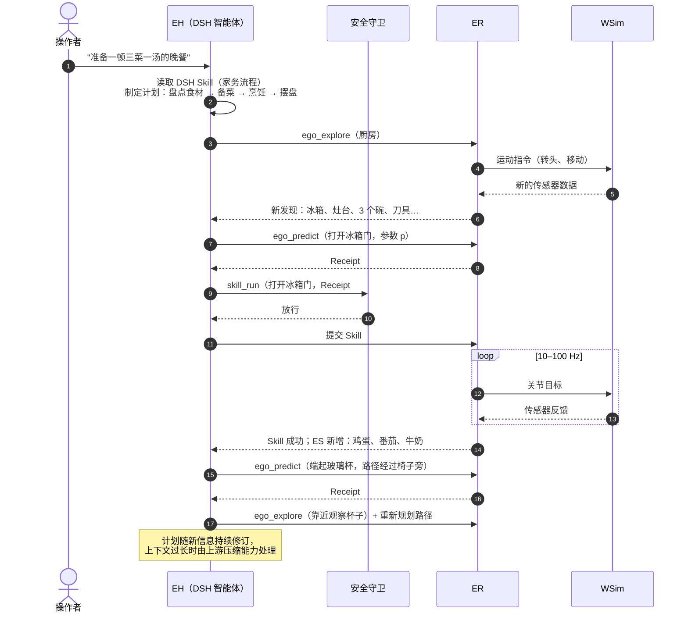
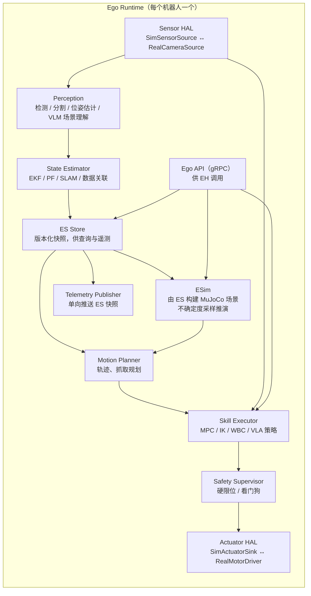
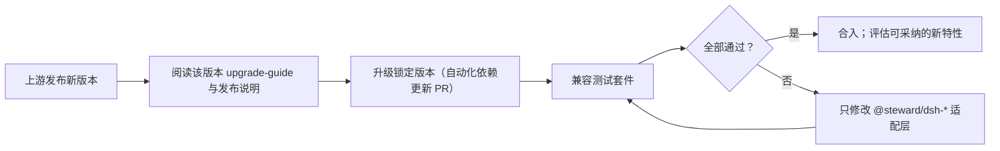

# Steward：基于 DeepSeek Harness 的具身智能机器人系统设计

## 1. 摘要

Steward 是一个用于构建、仿真和观察通用机器人自主行为的系统。它由两部分组成：

- **Steward 仿真与观察平面**：维护世界的 GT（Ground Truth，真实世界状态），模拟场景、物体与一个或多个机器人，为每个机器人渲染传感器输入，执行机器人发出的动作，并对比 GT 与各机器人的自我认知，评估其行为。
- **Ego 系统（机器人自我系统）**：每个机器人一套。它只通过自身传感器感知世界，持续维护一份局部且有误差的 ES（Ego-State，自我态），用 ESim（Ego-Simulation，自我仿真）预测动作后果，并用基于 DeepSeek Harness 的智能体完成长时任务规划（例如"准备一顿完整的晚餐"）、逐步身体控制和精细操作。

Ego 系统是本项目的核心产物，目标是通用机器人。仿真环境中的传感器输入来自 Steward 渲染；部署到实体机器人时，同一套 Ego 系统改为接入真实相机与执行器，上层代码不变。

本设计的硬性约束：**对 DeepSeek Harness 零侵入**。Steward 不修改、不 fork Harness 源码，只通过 Harness 公开的扩展点（插件、bundle、profile、patch、SDK）构建，从而持续获得上游新特性。

## 2. 术语与缩写

### 2.1 Steward 领域术语

| 术语 / 缩写 | 英文全称 | 定义 |
|---|---|---|
| Steward | Steward | 本系统名称；也指仿真与观察平面整体。 |
| WS | World State | 世界状态：场景、物体、机器人身体在某一时刻的完整物理状态。 |
| GT | Ground Truth | 真实值。仿真中 WS 即 GT，仅 Steward 平面可读。 |
| WSim | World Simulator | 世界仿真器：推进 WS 的物理引擎进程，是 GT 的唯一权威来源。 |
| Ego | Ego System | 机器人自我系统：一个机器人的感知、自我态、自我仿真、规划与控制的整体。 |
| ES | Ego-State | 自我态：机器人仅凭自身感知重建的近似世界状态，包含自身身体状态。它是局部的（未见过的物体不在其中）且有误差的（位置估计有不确定度）。 |
| ESim | Ego-Simulation | 自我仿真：机器人基于 ES 构建的内部物理模型，用于预测动作后果、做反事实推演。 |
| ER | Ego Runtime | 自我运行时：Ego 系统中非 LLM 的实时部分（感知、状态估计、ESim、技能执行、安全监督），独立于 Harness 的进程。 |
| EH | Ego Harness | 自我智能体：每个机器人一个 DeepSeek Harness 实例，负责任务理解、长时规划、技能编排与异常处理。 |
| EA | Ego Agent | 运行在 EH 中的智能体会话（Session）。 |
| ES Error | Ego-State Error | ES 相对 GT 的误差，只能由 Steward 平面计算。 |
| Observer | Observer | Steward 中只读采集 GT 与各机器人 ES 快照并计算指标的组件。 |
| Scenario | Scenario | 一次实验的场景定义：环境、物体、机器人初始状态、任务、扰动与评估规则。 |
| Episode | Episode | 一个 Scenario 的一次完整运行。 |
| Tick | Tick | 仿真时钟的一个固定步长。 |
| Skill | Skill | 可复用的中层动作能力，例如"抓取杯子""打开冰箱门"，由 ER 实时执行，EH 只负责选择与参数化。注意与 Harness 的 skill（指令文档）区分，后文称后者为 DSH Skill。 |
| Belief | Belief | 概率意义上的状态估计，ES 中每个物体的位姿以均值和协方差表示。 |
| Affordance | Affordance | 物体可被如何操作的属性，例如可抓取、可倾倒、易碎。 |
| Prediction Receipt | Prediction Receipt | ESim 完成一次动作后果预测后返回的凭据，安全守卫据此放行动作。 |

### 2.2 机器人与仿真技术缩写

| 缩写 | 英文全称 | 定义 |
|---|---|---|
| POMDP | Partially Observable Markov Decision Process | 部分可观测马尔可夫决策过程；机器人只能观测部分状态，正是 ES 的理论框架。 |
| SLAM | Simultaneous Localization and Mapping | 同时定位与建图。 |
| VIO | Visual-Inertial Odometry | 视觉惯性里程计。 |
| EKF | Extended Kalman Filter | 扩展卡尔曼滤波，用于融合观测更新物体位姿 belief。 |
| PF | Particle Filter | 粒子滤波，适合多模态 belief。 |
| DoF | Degrees of Freedom | 自由度；6-DoF 位姿即三维位置加三维姿态。 |
| SE(3) | Special Euclidean group in 3D | 三维刚体变换群，位姿的数学表示。 |
| IK | Inverse Kinematics | 逆运动学。 |
| MPC | Model Predictive Control | 模型预测控制。 |
| WBC | Whole-Body Control | 全身控制。 |
| VLA | Vision-Language-Action model | 视觉-语言-动作模型，直接输出低层动作的策略网络。 |
| VLM | Vision-Language Model | 视觉语言模型，用于场景理解与开放词汇检测。 |
| LLM | Large Language Model | 大语言模型。 |
| HAL | Hardware Abstraction Layer | 硬件抽象层，屏蔽仿真传感器与真实传感器的差异。 |
| Sim2Real | Simulation to Reality | 从仿真迁移到实体机器人。 |
| MuJoCo | Multi-Joint dynamics with Contact | 开源刚体与接触动力学引擎，推荐作为 WSim 与 ESim 的物理内核。 |
| MCAP | MCAP | 机器人领域常用的多通道时间序列日志格式。 |
| RT | Real-Time | 实时，指有确定时限的控制回路。 |
| IPC | Inter-Process Communication | 进程间通信。 |
| gRPC | gRPC Remote Procedure Call | 基于 HTTP/2 与 Protobuf 的 RPC 框架。 |
| ROS 2 / DDS | Robot Operating System 2 / Data Distribution Service | 机器人中间件及其底层发布订阅协议，可作为 ER 内部或 Sim2Real 的传输层。 |
| KPI | Key Performance Indicator | 评估指标。 |
| ACL | Anti-Corruption Layer | 防腐层：把外部系统的接口隔离在少量适配模块内，避免其变化扩散到业务代码。 |

### 2.3 DeepSeek Harness 术语

| 术语 / 缩写 | 定义 |
|---|---|
| DSH | DeepSeek Harness，命令行为 `dsh`。 |
| Cordis | DSH 底层插件框架；所有能力（模型适配、工具、会话日志、agent loop 本身）都是插件。 |
| Plugin | 向共享上下文贡献服务、事件监听和可撤销副作用的单元。 |
| Profile | 存放在 `$DSH_HOME/profiles/<name>` 的命名组合：有序 bundle 列表、仓外插件依赖和用户 `cordis.patch.yml`。 |
| Bundle | 携带一份 Cordis 配置 patch 及其插件代码的 npm 包，在 `package.json` 中以 `"dsh": { "bundle": { "patch": "./cordis.patch.yml" } }` 声明。 |
| Patch | 按行 id 替换或插入配置行的 YAML 层；叠加顺序为 profile 的 bundle、profile patch、home patch、启动时 `--patch`。 |
| Capability Seam | 可替换能力的三角色结构：Service Definition（接口）、Service Provider（实现）、Consumer（使用方，通常是模型工具）。 |
| Session | 一次持久化对话，底层是只追加的事件日志。 |
| Session Event | 日志中的一条事件；插件可通过 `SessionEventMap` 声明合并增加自己的事件类型。 |
| Agent Preset | 用 Cordis YAML 定义的一组智能体子插件，会话可选择其一。 |
| Subagent | 由主智能体派生的子智能体，用于委派子任务。 |
| Guard | 工具执行前的拦截与否决机制：`tools/pre-execute` 是可排序的策略层，`ctx.tools.guard()` 提供不可被后续监听器推翻的最终否决。 |
| SDK | DSH 的 TypeScript 与 Python SDK，通过 stdio JSON-RPC 启动并驱动一个 `dsh` 运行时。 |
| MCP | Model Context Protocol，DSH 可经 `dsh-mcp-client` 把外部 MCP 服务器的工具注册为模型工具。 |
| Upstream | `deepseek-ai/deepseek-harness` 官方仓库与其发布的 npm 包。 |

## 3. 设计目标与非目标

### 3.1 目标

1. **信息隔离**：机器人永远读不到 GT。Ego 系统只能经传感器通道获得信息，经执行器通道作用于世界。
2. **ES 收敛**：持续感知使 ES 的误差随时间下降、覆盖率随探索上升，且该过程可被 Steward 定量观察。
3. **后果预测**：动作执行前经 ESim 推演，阻止可预见的意外（绊倒家具、打碎玻璃杯、碰倒人）。
4. **长时任务**：能接受"准备一顿晚餐"这类多小时、多子目标的复杂指令，具备规划、执行、监控、重规划能力。
5. **Sim2Real 一致**：同一套 Ego 系统可在仿真和实体机器人上运行，差异只在 HAL 层。
6. **多机器人**：一个世界中可并存多个机器人，各自拥有独立 ES 与 EH。
7. **上游兼容**：零侵入 DSH，随上游升级获得新能力。

### 3.2 非目标

- 不把 LLM 放进实时控制回路；EH 不直接输出电机指令。
- 不修改 DSH 的 agent loop、会话格式或任何上游包。
- 不让 Steward 为机器人"代为感知"；Steward 只提供传感器原始数据（图像、深度、IMU、关节编码器等）。

## 4. 核心概念

### 4.1 WS 与 ES 的关系



ES 与 GT 有三类差异，Steward 分别度量：

| 差异 | 含义 | 度量示例 |
|---|---|---|
| 覆盖缺失 | 未见过的物体、未探索的空间不在 ES 中 | 物体召回率、已探索空间比例 |
| 估计误差 | 已知物体的位姿、尺寸、类别有偏差 | 位置误差（米）、姿态误差（度）、类别准确率 |
| 过时状态 | 物体被他人移动后 ES 尚未更新 | 状态陈旧时间、错误持有率 |

### 4.2 ES 数据模型

ES 是有版本号的快照序列，每次感知更新生成新版本。核心字段如下（示意，传输格式由 `ego-protocol` 定义）：

```ts
interface EgoState {
  version: number                 // 单调递增
  stamp: SimOrWallTime            // 产生时刻（仿真时间或真实时间）
  self: {
    basePose: PoseBelief          // 机身位姿（均值 + 协方差）
    joints: JointState[]          // 关节角、速度、力矩
    grasp: GraspState[]           // 各末端执行器持有的物体
  }
  objects: ObjectBelief[]
  freeSpace: OccupancyMap         // 已知空闲 / 已知占据 / 未知
  semantics: SceneGraph           // 房间、家具、"杯子在桌上"等关系
}

interface ObjectBelief {
  id: EgoObjectId                 // 机器人自己分配的 id，与 GT id 无关
  category: Distribution<string>  // 类别分布
  pose: PoseBelief                // SE(3) 均值 + 6x6 协方差
  shape: ShapeEstimate            // 几何近似（包围盒、网格、点云）
  physical: PhysicalEstimate      // 质量、摩擦、易碎度等先验或估计
  affordances: Affordance[]
  existence: number               // 存在概率
  lastObserved: SimOrWallTime
}
```

关键约束：

- ES 中的物体 id 由机器人自行分配。Observer 通过数据关联（匹配）把 ES 物体对应到 GT 物体来计算误差，机器人不知道 GT id。
- 不确定度是一等公民。ESim 与规划都必须使用协方差，不能只用均值。
- ES 的更新由 ER 中的状态估计器以传感器频率进行，与 EH 无关。

### 4.3 ESim：自我仿真

ESim 从当前 ES 构建一个内部物理场景（推荐同样使用 MuJoCo，但它和 WSim 是完全独立的实例与模型），用于：

1. **前向预测**：给定候选动作序列，推演未来几秒的状态，检查碰撞、跌落、倾倒、超力。
2. **不确定度采样**：从 belief 中采样多个场景（例如玻璃杯位置在误差范围内取 N 个样本），以最坏或分位数结果评估风险，而不是只看均值场景。
3. **主动感知建议**：当某动作的风险主要来自不确定度时，建议先"看清楚"（移动视角、靠近观察）再执行。
4. **事后校正**：比较预测结果与实际观测，修正 ES 中的物理参数（质量、摩擦）。

ESim 的输出是 Prediction Receipt，包含预测 id、所依据的 ES 版本、动作摘要、风险评分及主要风险项。EH 的安全守卫凭有效 receipt 才放行执行类工具。

### 4.4 分层控制与时间尺度

LLM 推理以秒计，电机控制以毫秒计。系统必须分层，并保证上层延迟不会阻塞下层：

| 层级 | 职责 | 频率 / 时间尺度 | 承载者 |
|---|---|---|---|
| L4 任务规划 | 理解指令、分解目标、长时计划、重规划 | 分钟到小时 | EH（DSH 智能体） |
| L3 技能编排 | 选择下一个 Skill 并参数化，监控结果 | 约 1 秒到数十秒 | EH 工具调用 |
| L2 运动规划与预测 | 轨迹规划、ESim 推演、风险评估 | 1–10 Hz | ER |
| L1 技能策略 | MPC、IK、WBC、VLA 策略 | 10–100 Hz | ER |
| L0 伺服 | 关节位置 / 力矩闭环 | 500 Hz–1 kHz | ER 或电机驱动器 |
| 感知与 ES 更新 | 检测、跟踪、滤波、建图 | 10–30 Hz | ER |

原则：EH 只下达"目标与约束"，不下达轨迹点。EH 卡住、断线或升级重启时，ER 依然能维持安全姿态（保持、减速、停止）。

## 5. 系统总体架构

### 5.1 全局视图



### 5.2 通道定义

机器人与外界之间只有以下通道，这是信息隔离的物理保证：

| 通道 | 方向 | 内容 | 仿真实现 | 实体实现 |
|---|---|---|---|---|
| 传感器通道 | 世界 → ER | 图像、深度、IMU、关节编码器、力 / 触觉 | Sensor Renderer 渲染 | 真实传感器驱动 |
| 执行器通道 | ER → 世界 | 关节目标、力矩、夹爪指令 | WSim 执行器输入 | 电机驱动器 |
| 指令通道 | 操作者 → EH | 自然语言任务、追加指令、中止 | DSH SDK（TS 或 Python） | 同左，或 Web / Desktop UI |
| 遥测通道 | ER → Observer | ES 快照、动作事件、ESim 预测 | 单向推送 | 可选，用于远程监控 |
| 机器人间通信（可选） | ER ↔ ER | 显式消息 | 经 Steward 模拟的无线信道（可加延迟、丢包） | 真实网络 |
| 控制通道 | Steward 内部 | 场景加载、时钟、扰动注入 | 内部 API | 不存在 |

隔离规则：

- ER 与 EH 的网络命名空间中不存在任何可访问 WSim 状态查询接口的路由或凭据。
- 遥测通道单向：Observer 只接收，不回写任何信息给机器人。
- 机器人之间不共享 ES 存储；协作只能经显式消息。
- Steward Director 只能经指令通道与机器人交互，不得把 GT 内容放进指令。Scenario 可以规定任务文本中允许出现的信息。

### 5.3 时钟模式

| 模式 | 行为 | 适用场景 |
|---|---|---|
| 实时 | WSim 以墙钟速度推进，LLM 延迟真实地消耗世界时间 | 评估真实部署表现 |
| 倍速 | 以固定倍率推进 | 加速长任务，但需确保 ER 实时回路跟得上 |
| 步进（lockstep） | WSim 每个 Tick 等待所有 ER 确认后再推进；EH 思考时间可选择计入或冻结 | 可复现实验、回归测试、调试 |

所有通道消息都携带仿真时间戳。ER 内部统一使用"当前时钟源"抽象：仿真中读 Sim Clock，实体机器人上读系统单调时钟。

## 6. 软件架构与 DeepSeek Harness 的关系

### 6.1 需要几个 Harness 实例？

| 组件 | 是否使用 DSH | 实例数 | 理由 |
|---|---|---|---|
| WSim / Renderer / Observer / Recorder | **否** | — | 它们是确定性的仿真与数据处理服务，不是智能体。放进 DSH 的回合式 agent loop 既无收益，又会把实时物理与 LLM 延迟耦合在一起。使用独立进程（Python / C++ + MuJoCo）。 |
| Steward Director | 可选，是 | 0 或 1 | 当需要用自然语言生成场景、批量派发任务、阅读日志写评估报告时，作为一个普通 DSH 智能体，通过工具调用 Steward API。它是"实验员"，不是世界本身。 |
| Ego Harness（EH） | **是** | **每个机器人 1 个** | 见下文。 |
| Ego Runtime（ER） | 否 | 每个机器人 1 个 | 实时回路不进入 DSH。 |

**为什么每个机器人一个独立的 DSH 实例，而不是一个 DSH 进程里跑多个智能体：**

1. **信息隔离可验证**：独立进程、独立 `DSH_HOME`、独立凭据与会话目录，机器人之间、机器人与 GT 之间不可能经内存或共享存储泄漏信息。
2. **与实体部署同构**：实体机器人上必然是"一台机器人一个 EH"。仿真时保持同一拓扑，Sim2Real 时无需重构。
3. **故障与升级隔离**：一个机器人的 EH 崩溃、重启或升级不影响其他机器人和世界仿真。
4. **会话日志即机器人"黑匣子"**：每个机器人的完整决策过程在自己的 Session 日志中，可单独回放与审计。
5. **独立配置**：不同型号的机器人（双臂、移动底盘、人形）可加载不同 bundle 与 preset。

单个 EH 内部仍可使用多智能体：主会话负责任务规划，Subagent 负责子任务（例如"检查冰箱里有哪些食材"），Agent Preset 为不同角色配置不同工具集。这些都是同一机器人"大脑"内部的分工，共享该机器人的 ES，不违反隔离。

### 6.2 进程与部署拓扑



建议每个机器人放在独立容器或虚拟机中，用网络策略落实 5.2 的隔离规则。实体模式下 Steward 平面不存在；若有动作捕捉系统，可作为近似 GT 接入 Observer，用于真实环境评估。

### 6.3 Ego Harness 插件组成

EH 是一个自定义 DSH profile。它从上游模板派生，叠加 Steward 自己的 bundle：



创建与安装方式全部使用上游命令，无需改动 DSH：

```sh
# 从上游 sdk 模板创建独立的 ego profile（复制模板的 bundle 列表，与模板无继承关系）
dsh --profile ego --from-default-profile sdk --dump-default-config >/dev/null

# 安装 Steward bundle；它会被追加到该 profile 的 bundle 层
dsh plugin --profile ego add @steward/dsh-bundle-ego

# 查看最终生效的配置树，任何一行都可以用 patch 覆盖
dsh --profile ego --dump-config
```

Bundle 的 `package.json` 声明：

```json
{
  "name": "@steward/dsh-bundle-ego",
  "dsh": { "bundle": { "patch": "./cordis.patch.yml" } },
  "peerDependencies": { "@deepseek-ai/cordis": "*" }
}
```

### 6.4 Capability Seam：`ctx.ego`

按 DSH 的 seam 规范，机器人能力拆为三个角色：

| 角色 | 包 | 职责 |
|---|---|---|
| Service Definition | `@steward/dsh-ego` | 定义 `ctx.ego` 接口：读取 ES、请求观察、请求 ESim 预测、提交 Skill、查询 Skill 状态、停止。与具体机器人、仿真或实机无关。 |
| Service Provider | `@steward/dsh-ego-runtime-client` | 经 gRPC 连接本机 ER，实现上述接口。连接地址、超时等为可配置的 `Config` 字段，配置错误在加载时失败。 |
| Service Provider（测试） | `@steward/dsh-ego-fake` | 脚本化 ER，用于无仿真环境的单元测试与会话快照测试。 |
| Consumer | `@steward/dsh-tool-ego` 等 | 模型工具、安全守卫、上下文注入、UI 插件。只依赖 Service Definition，从不依赖具体 Provider。 |

### 6.5 模型工具设计

工具面向模型的视角描述任务概念，不暴露传输与实现细节：

| 工具 | 作用 | 返回 |
|---|---|---|
| `ego_observe` | 获取指定相机的当前画面与可见物体摘要 | 文本摘要 + 图像附件（DSH 工具结果支持持久化图片附件） |
| `ego_query` | 按类别、区域、关系查询 ES 中的物体与其不确定度 | 结构化列表，含位置误差范围与最后观测时间 |
| `ego_explore` | 请求 ER 执行主动感知（转头、移动视角、靠近） | 新发现物体与不确定度变化 |
| `ego_predict` | 对候选 Skill 及参数进行 ESim 推演 | Prediction Receipt：风险评分、主要风险项、建议 |
| `skill_run` | 提交一个已预测的 Skill 给 ER 执行 | 执行凭据；长时执行以后台任务方式跟踪 |
| `skill_status` | 查询或等待 Skill 执行结果 | 进度、成功 / 失败原因、ES 变化摘要 |
| `body_stop` | 立即停止所有运动 | 停止确认 |

图像只在模型需要时按需返回，不把连续视频流塞进上下文；连续感知由 ER 在 ES 中消化，模型主要读结构化 ES 摘要，从而控制 token 与 KV-cache 开销。

### 6.6 安全守卫

安全分两层，互相独立：

1. **EH 层守卫（`@steward/dsh-robot-safety`）**
   - 在 `tools/pre-execute` 中检查：`skill_run` 必须携带有效且未过期的 Prediction Receipt，receipt 依据的 ES 版本不能落后太多，风险评分低于阈值，动作在允许的工作空间与速度范围内。
   - 用 `ctx.tools.guard()` 注册最终否决，保证其他插件的监听顺序无法绕过。
   - 急停注册为 `ctx.commands` 上的人类命令，不经过模型回合直接生效。
   - 被否决的动作写入 `robot/safety-veto` 事件，模型在工具结果中看到否决原因并重新规划。
2. **ER 层安全监督（与 LLM 完全无关）**
   - 力矩、速度、碰撞距离硬限位；看门狗：EH 失联超时则进入安全停止。
   - 即使 EH 被错误配置、被提示词注入或升级出错，ER 层仍然有效。

阈值、工作空间范围等都是 bundle 配置字段，可在 profile patch 中按机器人型号调整。

### 6.7 会话日志与"模型可见即已记录"

DSH 要求模型看到的一切都能从会话日志重建。Steward 遵循这一规则：

- `@steward/dsh-ego-context` 在每次模型请求前通过 `agent.inject()` 注入 ES 增量摘要（新发现的物体、显著变化、执行中的 Skill 状态）。该内容进入日志，回放时可重建。
- `@steward/dsh-ego-events` 通过 `SessionEventMap` 声明合并增加仅日志事件（不进入模型历史）：

| 事件 | 内容 |
|---|---|
| `ego/snapshot-ref` | 该时刻 ES 版本号及其在 Recorder 中的引用，用于把会话与传感器日志对齐 |
| `robot/prediction` | Prediction Receipt 摘要 |
| `robot/skill-dispatched` | 提交给 ER 的 Skill 与参数 |
| `robot/skill-result` | 执行结果与 ES 变化 |
| `robot/safety-veto` | 守卫否决及原因 |

- 原始传感器数据和完整 ES 不写入 DSH 会话（体积过大），只记录引用；完整数据由 Recorder 以 MCAP 保存。

### 6.8 长时任务：以"准备一顿晚餐"为例



可直接复用的上游能力：

| 需求 | 上游能力 |
|---|---|
| 子任务委派 | Subagent、Agent Preset |
| 长时执行的 Skill 跟踪 | 后台 Jobs |
| 计划与进度 | todo / plan / goal 相关插件 |
| 长任务上下文控制 | 会话压缩（compaction） |
| 中断后恢复 | 会话持久化与 SDK `resumeSession` |
| 领域流程知识 | DSH Skill 加载 |
| 外部工具快速接入 | MCP client（适合原型；正式能力应落到一等插件以纳入守卫和日志） |

### 6.9 Ego Runtime 内部架构

ER 不依赖 DSH，可用 Python / C++ 实现，也可内部使用 ROS 2：



ES 的持续收敛来自 State Estimator：每帧观测与已有 belief 融合，重复观测降低协方差，新视角揭示新物体，ESim 的预测与实际结果对比用于校正物理参数。Observer 记录 ES Error 随时间的曲线，作为感知与估计算法的核心评估指标。

### 6.10 Sim2Real 替换表

| 组件 | 仿真模式 | 实体模式 | 是否改代码 |
|---|---|---|---|
| Sensor HAL | `SimSensorSource`（接 Renderer） | `RealCameraSource` 等 | 换实现，接口不变 |
| Actuator HAL | `SimActuatorSink`（接 WSim） | `RealMotorDriver` | 换实现，接口不变 |
| 时钟源 | Sim Clock | 系统单调时钟 | 配置切换 |
| 感知、估计、ESim、规划、执行 | 同一代码 | 同一代码 | 否（模型参数可单独标定） |
| EH 与全部 DSH 插件 | 同一 bundle | 同一 bundle | 否；仅 profile patch 调整阈值 |
| Steward 平面 | 存在 | 不存在（可选动作捕捉作为近似 GT） | — |

## 7. 防止与上游分叉的原则

这是本设计的硬约束。目标是：上游每次发布后，Steward 只需"升级版本号 + 跑兼容测试"，而不是合并代码。

### P1 零侵入，独立仓库

- Steward 是独立仓库，以 npm 依赖方式使用 `@deepseek-ai/dsh` 及相关包，**锁定精确版本**。
- 不 fork、不 vendor、不打补丁到 `packages/`、`vendor/` 或任何上游文件，也不依赖上游仓库的内部路径或未导出模块。
- 本地克隆的上游仓库只用于阅读源码和运行上游自身的检查。

### P2 只使用文档化扩展点

| Steward 需求 | 上游扩展点 |
|---|---|
| 模型工具 | 在 `ctx.tools` 注册 |
| 机器人能力接口 | 自定义 Capability Seam（`ctx.ego`） |
| 动作审批与否决 | `tools/pre-execute`、`ctx.tools.guard()` |
| 急停与人类命令 | `ctx.commands` |
| 向模型注入 ES 上下文 | `agent.inject()` |
| 持久化自有状态 | `SessionEventMap` 声明合并（仅日志事件） |
| 角色与能力组合 | Agent Preset |
| UI | 读取 `session/event` 的客户端插件、Chat 节点注册 |
| 外部驱动 | DSH SDK（TS / Python） |
| 组合与配置 | profile + bundle + patch |

现有扩展点不够用时，**不绕过**，而是向上游提 issue / PR 请求新的扩展点；在上游合入前，用自有插件实现最小替代方案并登记在"兼容性登记表"中，上游能力可用后立即迁移。

### P3 只经 profile 启动

上游规定受支持的 Node 应用只能通过命名 `dsh` profile 启动。Steward 不发布自定义可执行文件，不直接在进程内挂载插件树：EH 一律以 `dsh --profile ego` 运行，测试脚本与 Steward Director 经 SDK 启动它。

### P4 组合优先于复制

- EH profile 从上游模板派生，以 bundle 叠加 Steward 能力，不复制上游配置树。这样上游在 `dsh-base` 中新增或改进的通用能力（模型适配、压缩、持久化、subagent 等）自动生效。
- 需要关闭的上游能力用 patch 按行 id 覆盖，并在 bundle 文档中写明原因（例如机器人 profile 禁用不需要的浏览器工具）。
- 副作用是上游新增工具会自动出现在机器人的工具列表中。为此建立**工具清单快照测试**：每次升级时对比 `--dump-config` 与工具 schema 列表，新出现的工具必须经人工评审后明确保留或禁用。若某型号机器人需要严格固定能力集，可改为参照上游 `sdk-minimal` 的方式自持完整配置树，代价是上游新能力需要显式引入。

### P5 防腐层：DSH 依赖只出现在适配包

- `ego-protocol`（传输协议）、ER、WSim、Observer **零 DSH 依赖**。
- 所有 `@deepseek-ai/*` 导入集中在 `@steward/dsh-*` 适配包中。上游 API 变化（公开 API 仍为 pre-stable）只影响这一层。
- 这样 Ego 系统的实时部分可以独立演进，甚至在不使用 DSH 的场景中复用。

### P6 遵守上游运行时约定

- **模型可见即已记录**：所有进入模型请求的内容都可从会话日志重建。
- **Seam 完整**：每个能力同时设计 Definition / Provider / Consumer；Consumer 依赖 Definition 而非具体 Provider。
- **注册即副作用**：所有注册经 `ctx.effect()` / `ctx.on()`，插件卸载时可撤销，支持上游的热重载。
- **配置不硬编码**：部署相关参数（端点、阈值、超时）都是校验过的 `Config` 字段；配置错误在加载时立即失败。
- **跨边界 id 带品牌类型**：例如 `EgoObjectId`、`PredictionId` 不使用裸 `string`。

### P7 持久化兼容

- 自有事件使用独立命名空间（`ego/*`、`robot/*`），只做仅日志事件，不改变上游消息投影。
- 不直接读写 DSH 会话文件的物理格式；查询与导出使用上游 session-query、SDK 等公开接口。
- 关注上游会话格式版本说明与升级指南；会话格式升级时，用上游迁移路径处理，不自行改写日志。

### P8 升级流程与兼容测试



兼容测试套件包括：

1. **配置快照**：`dsh --profile ego --dump-config` 的差异评审。
2. **工具 schema 快照**：模型可见的工具名称、描述、参数。
3. **真实组合测试**：通过 Loader 启动测试用 profile，配合 `dsh-ego-fake`，断言模型可见输出、会话事件与守卫行为（遵循上游"产品可见插件需要真实组合测试"的原则）。
4. **录制会话回放**：用录制的模型响应回放典型任务，无需 API key 即可在 CI 中运行。
5. **仿真冒烟**：在轻量 Scenario 中跑一个完整 Episode。
6. **Canary**：定期针对上游最新预发布版本运行同一套件，提前发现破坏性变化，而不是等到正式升级时才处理。

### P9 主动采纳上游新特性

每次升级后评审上游新增能力，优先以**配置**方式采纳，例如新的模型适配、上下文压缩策略、subagent 提供者、goal / schedule 能力、实验性 Agent Teams。采纳记录写入兼容性登记表，以便追踪哪些 Steward 自有实现可以被上游能力替代并删除。

### P10 实时安全与 agent loop 解耦

DSH 不在任何实时回路中，ER 层安全监督不依赖 EH。因此上游对 agent loop、模型适配、会话机制的任何改动，都不可能破坏机器人的底层安全保证；最坏情况是 EH 不可用，ER 进入安全停止。

### 反模式清单

| 不要做 | 原因 |
|---|---|
| 修改上游 `packages/` 中的代码以"临时"支持机器人功能 | 每次升级都要重新合并，最终无法跟进上游 |
| 在一个 DSH 进程中运行多个机器人 | 破坏信息隔离，与实体部署不同构 |
| 把 WSim 做成 DSH 插件或工具 | 实时物理与 LLM 回合耦合；GT 有泄漏到机器人上下文的风险 |
| 让 EH 直接下发轨迹点或电机指令 | LLM 延迟与不确定性进入控制回路 |
| 在 ER 或协议层直接引用 `@deepseek-ai/*` 类型 | 上游 API 变化会扩散到实时系统 |
| 绕过 profile，自己写启动器挂载插件树 | 违反上游启动约定，失去 profile、patch 和插件管理能力 |
| 把原始图像流写进会话或模型上下文 | 日志膨胀、token 成本失控 |
| 依赖上游未导出的内部模块或会话文件格式 | 无兼容承诺，随时可能变化 |

## 8. Steward 平面详细设计

### 8.1 WSim

- MuJoCo 世界模型，固定步长推进，是 GT 唯一来源。
- 支持多机器人、关节物体（门、抽屉、冰箱）、可破坏或状态可变物体（玻璃杯破碎、液体倾倒可用事件化近似）。
- 对外提供：执行器输入接口、状态查询接口（仅 Steward 内部可达）、事件流（碰撞、跌落、破碎）。

### 8.2 Sensor Renderer

- 按每个机器人的相机内外参从 WS 渲染 RGB、深度、分割（分割仅用于评估，不发给机器人）。
- 噪声与失真模型：曝光、模糊、深度噪声、延迟、丢帧、遮挡，可在 Scenario 中配置，用于检验 ES 估计的鲁棒性。
- 本体感受数据（关节编码器、IMU、力传感器）同样加噪后发送。

### 8.3 Observer 与评估

| 类别 | KPI |
|---|---|
| ES 质量 | 物体召回率、位置 / 姿态误差、类别准确率、陈旧率、误差随时间的下降曲线 |
| 预测质量 | ESim 预测与实际结果的偏差、风险预测的校准度（预测风险 vs 实际事故率） |
| 安全 | 碰撞次数、跌落 / 破碎事件、守卫否决次数与正确性 |
| 任务 | 子目标完成率、总耗时、重规划次数、人工干预次数 |
| 成本 | 模型调用次数、token 数、平均决策延迟 |

Observer 只读取 GT 与遥测通道数据，结果写入 Recorder 并显示在 Console，永不回传给机器人。

### 8.4 Recorder 与回放

- WSim 状态、传感器数据、ES 快照、遥测事件以 MCAP 记录。
- 每个机器人的 DSH 会话日志通过 `ego/snapshot-ref` 事件与 MCAP 时间轴对齐，实现"决策—感知—世界"三方同步回放。

### 8.5 Steward Director（可选）

一个独立的 DSH 实例（例如 `dsh --profile steward-director`），加载 Steward 自有的 Director bundle：

- 工具：加载 / 生成 Scenario、启动与停止 Episode、读取 KPI、读取回放摘要。
- 经 SDK 向各机器人 EH 派发任务（与人类操作者使用同一指令通道）。
- 生成评估报告。
- 它可以读 GT（它属于 Steward 平面），因此**必须**与机器人 EH 处于不同进程与凭据域，并且由 Scenario 规则限制其向机器人发送的内容。

## 9. 仓库与包结构

```
steward/
├── protocol/                     # ego-protocol：Protobuf / gRPC 定义（零 DSH 依赖）
├── world/                        # WSim、Renderer、Scenario、Clock（Python / C++，MuJoCo）
├── observer/                     # Observer、Evaluator、Recorder
├── console/                      # Steward Console（3D 可视化与回放）
├── ego-runtime/                  # ER：HAL、感知、估计、ESim、规划、执行、安全监督
│   ├── hal-sim/
│   └── hal-real/
├── dsh/                          # 仅此目录依赖 @deepseek-ai/*（防腐层）
│   ├── dsh-ego/                  # Service Definition
│   ├── dsh-ego-runtime-client/   # Service Provider
│   ├── dsh-ego-fake/             # 测试 Provider
│   ├── dsh-tool-ego/             # 模型工具
│   ├── dsh-robot-safety/         # 守卫与急停
│   ├── dsh-ego-context/          # agent.inject 上下文
│   ├── dsh-ego-events/           # SessionEventMap 扩展
│   ├── dsh-ego-presets/          # Agent Preset
│   ├── dsh-skills-household/     # DSH Skill
│   ├── client-ui-ego/            # Web / Desktop 客户端插件
│   ├── dsh-bundle-ego/           # EH bundle
│   └── dsh-bundle-director/      # Steward Director bundle
├── scenarios/                    # Scenario 定义与基准任务集
├── compat/                       # 兼容测试：配置快照、工具快照、录制会话、canary
└── docs/
    └── compatibility-register.md # 兼容性登记表：临时替代方案与已采纳上游特性
```

## 10. 测试策略

| 层级 | 内容 | 依赖 |
|---|---|---|
| 单元测试 | ER 各模块、DSH 插件逻辑（使用 `dsh-ego-fake`） | 无仿真、无 API key |
| 真实组合测试 | 经 Loader 启动测试 profile，断言工具 schema、守卫否决、会话事件 | 无仿真、无 API key |
| 录制会话回放 | 回放典型任务的模型响应，检查 Steward 插件行为 | 无 API key |
| 仿真集成 | 单机器人 / 多机器人 Scenario 完整 Episode | 仿真、可选 API key |
| 基准评估 | 固定 Scenario 集（整理桌面、开冰箱取物、做早餐…）跑 KPI | 仿真、API key |
| 上游兼容 | 第 7 节 P8 的完整套件，含 canary | 视项目而定 |

## 11. 分阶段路线图

| 阶段 | 范围 | 验收标准 |
|---|---|---|
| Phase 0 | 单机器人、静态场景、理想感知（ES 直接来自加噪 GT，仅用于打通链路）；EH 工具与守卫 | 完成"把杯子放到桌上"类任务；兼容测试套件可运行 |
| Phase 1 | 真实感知链路：渲染 → 检测 → 估计；ES 收敛评估 | ES Error 随探索稳定下降，指标在 Console 可见 |
| Phase 2 | ESim 与不确定度推演；Prediction Receipt 守卫 | 在含易碎物体的场景中，事故率显著低于无 ESim 基线 |
| Phase 3 | 精细操作 Skill（VLA / MPC）；长时任务（做一顿早餐） | 多子目标任务完成率达到设定阈值 |
| Phase 4 | 多机器人与显式通信 | 两台机器人协作完成任务且无信息泄漏 |
| Phase 5 | 实体机器人：Real HAL、标定、动作捕捉近似 GT | 同一 EH bundle 无代码修改在实机上完成 Phase 3 任务 |

## 12. 待决问题

1. ESim 的物理保真度与推演成本如何折中？是否需要学习型世界模型与物理引擎混合？
2. 步进时钟模式下，EH 的思考时间计入还是冻结，对评估结论的影响如何量化？
3. Skill 库的粒度：多少由 VLA 端到端完成，多少由显式规划组合？
4. 多机器人通信协议的语义层级（共享观测、共享意图、任务分配）。
5. 实体部署时 EH 的模型推理位置（本机、边缘服务器、云端）与断网降级策略。
6. 哪些 Steward 能力适合反馈给上游成为通用扩展点（例如面向连续物理系统的工具执行时限语义）。
